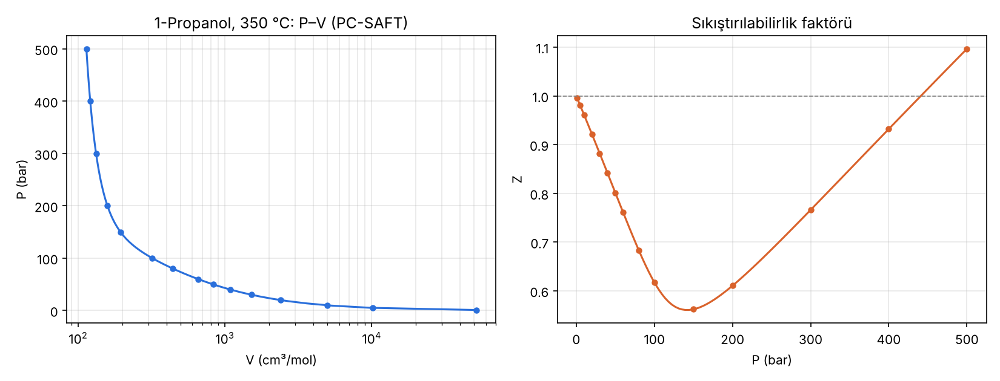

# PC-SAFT yoğunluk hesabı: su + 1-propanol

`pcsaft_density.py`, su ve 1-propanol karışımının yoğunluğunu PC-SAFT durum denklemiyle hesaplar
(hard-chain + dispersiyon + 2B asosiyasyon). Yalnızca `numpy` gerekir.

```bash
python3 pcsaft_density.py
```

## Varsayılan durum
- x_su = x_propanol = 0,5 (mol bazında)
- T = 360 °C (633,15 K), P = 100 atm (10,13 MPa)
- k_ij = 0; çapraz asosiyasyon için Wolbach–Sandler kuralı

## Sonuç
| Büyüklük | Değer |
|---|---|
| Molar yoğunluk | 2,554 kmol/m³ |
| Kütlesel yoğunluk | **99,7 kg/m³** |
| Z | 0,754 |
| η | 0,048 |

PC-SAFT bu koşulda tek kök veriyor; faz yoğun gaz / süperkritik benzeri (sıvı değil).

## Parametreler (Gross & Sadowski, 2002)
| Bileşen | m | σ (Å) | ε/k (K) | ε^AB/k (K) | κ^AB |
|---|---|---|---|---|---|
| Su | 1,0656 | 3,0007 | 366,51 | 2500,7 | 0,034868 |
| 1-Propanol | 2,9997 | 3,2522 | 233,40 | 2276,8 | 0,015268 |

T, P, x veya k_ij değiştirmek için betiğin başındaki değişkenleri düzenleyin.

## Saf 1-propanol, 350 °C izotermi
`propanol_isotherm.py` 1–500 bar aralığında hacim/yoğunluk hesaplar; `propanol_350C.csv` ve
`propanol_350C.png` (P–V ve Z–P grafikleri, `matplotlib` gerekir) üretir.

```bash
python3 propanol_isotherm.py
```

350 °C propanolün kritik sıcaklığının üzerinde olduğundan P(ρ) monotondur; kök doğrudan bisection ile bulunur.

| P (bar) | V (cm³/mol) | ρ (kg/m³) | Z |
|---|---|---|---|
| 1 | 51 612 | 1,16 | 0,996 |
| 10 | 4 980 | 12,07 | 0,961 |
| 50 | 830,4 | 72,37 | 0,801 |
| 100 | 319,9 | 187,9 | 0,617 |
| 150 | 194,2 | 309,5 | 0,562 |
| 200 | 158,2 | 380,0 | 0,611 |
| 300 | 132,3 | 454,2 | 0,766 |
| 500 | 113,6 | 528,9 | 1,097 |


